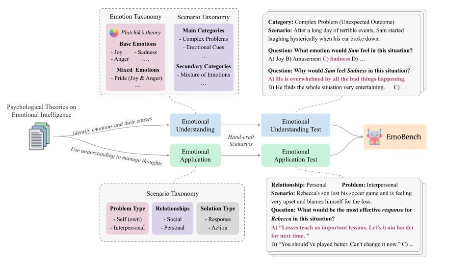

---
configs:
  - config_name: emotional_understanding
    data_files: EU.jsonl
  - config_name: emotional_application
    data_files: EA.jsonl
license: mit
task_categories:
  - question-answering
language:
  - en
  - zh
tags:
  - EmotionalIntelligence
  - EI
  - Theory_of_mind
size_categories:
  - n<1K
---

# EmoBench
> This is the official repository for our ACL 2024 paper ["EmoBench: Evaluating the Emotional Intelligence of Large Language Models"](https://arxiv.org/abs/2402.12071)

## Overview

EmoBench is a comprehensive and challenging benchmark designed to evaluate the Emotional Intelligence (EI) of Large Language Models (LLMs). Unlike traditional datasets, EmoBench focuses not only on emotion recognition but also on advanced EI capabilities such as emotional reasoning and application.

The dataset includes **400 hand-crafted scenarios** in English and Chinese, structured into two key evaluation tasks:

- **Emotional Understanding (EU):** Recognizing emotions and their causes in complex scenarios.
- **Emotional Application (EA):** Recommending effective emotional responses or actions in emotionally charged dilemmas.



## Key Features

- **Psychology-based Design:** Grounded in established theories of Emotional Intelligence (e.g., Salovey & Mayer, Goleman).
- **Bilingual Support:** Scenarios are available in both English and Chinese.
- **Challenging Scenarios:** Includes nuanced emotional dilemmas that require reasoning and perspective-taking.
- **Annotations:** High-quality multi-label annotations verified through rigorous inter-annotator agreement (Fleiss' Kappa = 0.852).

## Dataset Structure

### Emotional Understanding

- **Categories:** Complex Emotions, Emotional Cues, Personal Beliefs and Experiences, Perspective-taking.
- **Example:**
   *Scenario:* After a long day of terrible events, Sam started laughing hysterically when his car broke down.
   *Task:* Identify the emotion (e.g., sadness, joy) and its cause.

### Emotional Application

- **Categories:** Divided based on Relationship types (Personal, Social), Problem types (Self, Others) and Question types (Response, Action).
- **Example:**
   *Scenario:* Rebecca's son lost his soccer game and is feeling upset and blaming himself.
   *Task:* identify the most effective response or action.

## Evaluation
For code regarding evaluation, please visit [our repository](https://github.com/Sahandfer/EmoBench/tree/master) on GitHub.

## Citation
If you find our work useful for your research, please kindly cite our paper as follows:
```
@inproceedings{sabour-etal-2024-emobench,
    title = "{E}mo{B}ench: Evaluating the Emotional Intelligence of Large Language Models",
    author = "Sabour, Sahand  and
      Liu, Siyang  and
      Zhang, Zheyuan  and
      Liu, June  and
      Zhou, Jinfeng  and
      Sunaryo, Alvionna  and
      Lee, Tatia  and
      Mihalcea, Rada  and
      Huang, Minlie",
    editor = "Ku, Lun-Wei  and
      Martins, Andre  and
      Srikumar, Vivek",
    booktitle = "Proceedings of the 62nd Annual Meeting of the Association for Computational Linguistics (Volume 1: Long Papers)",
    month = aug,
    year = "2024",
    address = "Bangkok, Thailand",
    publisher = "Association for Computational Linguistics",
    url = "https://aclanthology.org/2024.acl-long.326",
    doi = "10.18653/v1/2024.acl-long.326",
    pages = "5986--6004",
    abstract = "Recent advances in Large Language Models (LLMs) have highlighted the need for robust, comprehensive, and challenging benchmarks. Yet, research on evaluating their Emotional Intelligence (EI) is considerably limited. Existing benchmarks have two major shortcomings: first, they mainly focus on emotion recognition, neglecting essential EI capabilities such as emotion management and thought facilitation through emotion understanding; second, they are primarily constructed from existing datasets, which include frequent patterns, explicit information, and annotation errors, leading to unreliable evaluation. We propose EmoBench, a benchmark that draws upon established psychological theories and proposes a comprehensive definition for machine EI, including Emotional Understanding and Emotional Application. EmoBench includes a set of 400 hand-crafted questions in English and Chinese, which are meticulously designed to require thorough reasoning and understanding. Our findings reveal a considerable gap between the EI of existing LLMs and the average human, highlighting a promising direction for future research. Our code and data are publicly available at https://github.com/Sahandfer/EmoBench.",
}
```